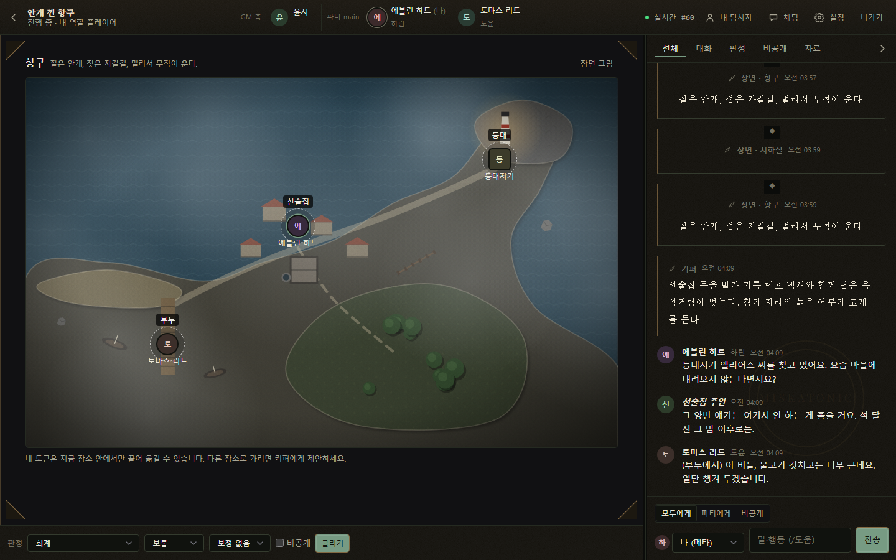
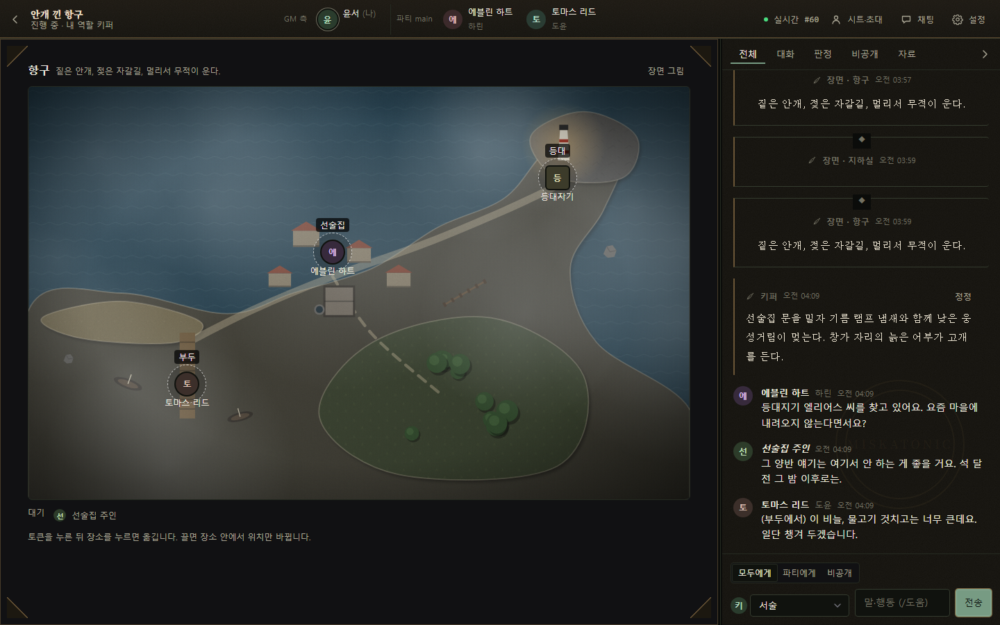
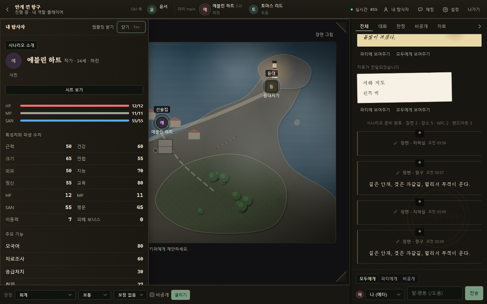
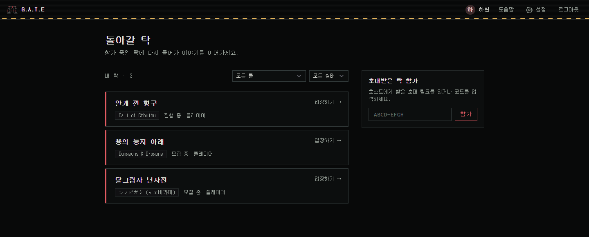
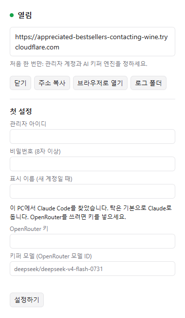

# G.A.T.E

**Game-master Agent Tabletop Environment**

친구들과 브라우저로 모이는 TRPG 탁. 
내 PC에서 앱 하나만 켜면 탁 서버, AI 키퍼, 친구 접속 주소가 한 번에 열립니다.

### [⬇ 설치 파일 받기](https://github.com/YeeDochi/G.A.T.E-released/releases/latest)

Call of Cthulhu 7판 · D&D 5판 · 시노비가미 · 인세인 · PARANOIA 룰로 플레이할 수 있습니다

 

## 이런 앱입니다

- 🏰 **켜면 열리고, 끄면 닫힘**: 앱을 켜면 탁 서버와 데이터베이스, 친구들이 들어올 공개 주소가 한 번에 열립니다. 끄면 전부 닫혀서 PC에 아무것도 남지 않습니다.
- 🎲 **AI 키퍼**: 진행(Master), 규칙 판단(Judge), NPC 연기를 AI가 나눠 맡습니다. Claude Code가 있으면 그것으로, 없으면 OpenRouter 키 하나로 돌아갑니다.
- ⚖️ **판정은 서버가**: 주사위, HP·SAN, 전투 순서, 비공개 정보는 AI가 아니라 서버가 계산하고 기록합니다. AI는 제안하고, 서버가 확인한 것만 남습니다.
- 🌐 **친구는 설치 없이**: 친구들은 주소만 열면 브라우저에서 바로 참가합니다.
- 📜 **시나리오 넣기**: 가진 시나리오 PDF를 넣으면 AI가 장면·NPC·핸드아웃으로 정리해 탁을 준비합니다.
- 🔄 **자동 업데이트**: 새 버전은 앱이 알아서 받아 두었다가, 다음에 종료할 때 설치합니다.

## 화면

<table>
  <tr>
    <td width="50%"></td>
    <td width="50%"></td>
  </tr>
  <tr>
    <td><b>키퍼</b> 장면 지도에서 토큰을 옮기고, 서술과 NPC 대사를 보내고, 판정을 요청합니다.</td>
    <td><b>탐사자 시트</b> 수치는 서버가 계산하고, HP·MP·SAN은 판정과 피해에 따라 바로 바뀝니다.</td>
  </tr>
  <tr>
    <td></td>
    <td align="center"></td>
  </tr>
  <tr>
    <td><b>로비</b> 내 탁을 룰과 상태로 모아 봅니다. 초대 코드로 참가합니다.</td>
    <td><b>호스트 앱</b> 트레이에 머무는 작은 창입니다. 친구 접속 주소를 복사하고, 열고 닫습니다.</td>
  </tr>
</table>

## 시작하기

### 1. 설치

1. [최신 릴리즈](https://github.com/YeeDochi/G.A.T.E-released/releases/latest)에서 `GATE-Setup-<버전>.exe`를 받아 실행합니다.
2. Windows가 "PC 보호" 경고를 띄우면 **추가 정보 → 실행**을 누릅니다. 아직 코드 서명이 없어서 나오는 경고입니다.
3. 설치가 끝나면 앱이 열리고, 작업 표시줄 오른쪽(트레이)에 G.A.T.E 아이콘이 생깁니다.

### 2. 첫 설정 (한 번만)

상태 창에 **첫 설정** 칸이 보입니다.

- **관리자 아이디·비밀번호**: 이 탁 서버의 주인 계정입니다.
- **AI 키퍼 엔진**
  - 이 PC에 Claude Code가 있으면 앱이 찾아서 알려 줍니다. 키 없이 그대로 쓸 수 있습니다.
  - 없으면 [OpenRouter](https://openrouter.ai/keys) 키(`sk-or-…`)를 넣습니다. 모델은 기본값(DeepSeek)이면 충분합니다.

**설정하기**를 누르면 계정과 AI 러너가 준비됩니다.

 

### 3. 탁 열고 친구 부르기

1. 트레이 메뉴의 **브라우저로 열기**로 들어가 로그인합니다.
2. 탁을 만들고, 탁 안에서 **초대 코드**를 만듭니다.
3. 트레이 메뉴의 **친구 접속 주소 복사**로 주소를 복사해서, 초대 코드와 함께 친구들에게 보냅니다.
4. 친구들은 그 주소를 열고, 초대 코드로 가입해서 들어옵니다.

트레이 아이콘의 점이 **초록**이면 열린 상태입니다. 노랑은 여는 중, 회색은 닫힘, 빨강은 문제가 생긴 상태입니다.

 

## 알아 두면 좋은 것

- **접속 주소는 켤 때마다 바뀝니다.** 앱을 다시 켰다면 새 주소를 친구들에게 다시 보내 주세요.
- **앱을 끄면 친구들 접속도 끊깁니다.** 탁 내용은 그대로 남아서 다음에 이어서 할 수 있습니다.
- **탁 데이터는 내 PC에 있습니다.** `%LOCALAPPDATA%\GATE`에 저장되고, 앱을 지워도 남습니다.
- **지우기**: Windows 설정 → 앱 → 설치된 앱 → **G.A.T.E**. 실행 중이어도 먼저 모두 닫고 지웁니다.

<b>자주 묻는 질문</b>

 

**친구들도 앱을 깔아야 하나요?** 
아니요. 호스트 한 명만 설치하면 되고, 친구들은 브라우저로 들어옵니다.

**AI 비용은 얼마나 드나요?** 
Claude Code를 쓰면 호스트의 Claude 구독으로 돕니다. OpenRouter를 쓰면 고른 모델의 사용량만큼 OpenRouter에 냅니다. 기본 모델(DeepSeek)은 싼 편입니다.

**Mac에서도 되나요?** 
아직은 Windows 10/11 64비트만 지원합니다.

**업데이트는 어떻게 하나요?** 
따로 할 일이 없습니다. 앱이 새 버전을 받아 두면 트레이 메뉴에 "업데이트 설치하고 다시 시작"이 생기고, 그냥 종료해도 그때 설치됩니다.

**Windows가 설치 파일을 막아요.** 
"추가 정보 → 실행"을 누르면 됩니다. 코드 서명은 나중에 붙일 예정입니다.

---

이 저장소에는 설치 파일만 올라옵니다. Call of Cthulhu, Dungeons & Dragons, PARANOIA, 인세인, 시노비가미 등 룰셋 이름은 각 권리자의 상표이며, G.A.T.E는 그 권리자들과 무관한 비공식 팬 도구입니다. 룰셋 로고는 G.A.T.E가 직접 만든 것입니다. 룰북과 시나리오의 문장은 들어 있지 않습니다.
